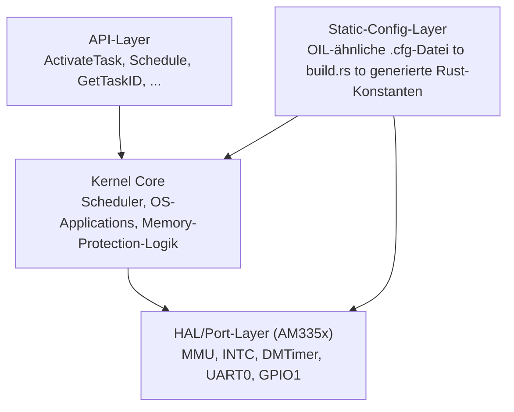

# RT-OS für BeagleBone Black in Rust – Projektplan

2026-09-16

## Zielsetzung

Ein eigener, AUTOSAR-OS-konformer Realtime-Kernel in Rust auf der BeagleBone Black (AM335x/Cortex-A8) — als Portfolio-Beweis für tiefes AUTOSAR-Verständnis, nicht als Produkt.

Projektname: **rOSEK** (Rust + OSEK/AUTOSAR OS).

- Zielgruppe: Bewerbungen für Embedded-/Automotive-Architektur-Rollen im DACH-Raum
- Abgrenzung zu bestehenden Projekten: eigenständiges Repo, getrennt von `beaglebone_black` (Embedded Linux) und `minilink` (ELF-Linker)
- Kernaussage nach außen: "AUTOSAR-OS-Kernel aus der Spezifikation (SWS\_OS) implementiert", nicht "ERIKA nach Rust portiert"

## Scope-Abgrenzung

Clean-Room-Implementierung nach der offenen AUTOSAR-OS-Spezifikation (SWS\_OS), keine Übernahme fremden Codes.

- Kein Fork/Port von ERIKA Enterprise (dual GPLv2/kommerziell lizenziert — würde Lizenzpflichten übernehmen)
- Referenz sind die AUTOSAR-Spezifikationsdokumente und OSEK/VDX OS als deren Basis, nicht fremder Quellcode
- Projektname enthält nicht "AUTOSAR" (geschützte Marke des Konsortiums); README beschreibt das Projekt als "AUTOSAR OS-konform (SWS\_OS)"
- Lizenz für das eigene Projekt: offen, siehe Offene Punkte

## Zielhardware

BeagleBone Black mit TI-SoC AM335x, ARM Cortex-A8 (ARMv7-A), Single-Core.

| Merkmal | Wert |
| --- | --- |
| CPU | Cortex-A8 @ 1 GHz |
| FPU | VFPv3-D16 (kein NEON) |
| MMU | vorhanden — Basis für Memory Protection |
| Interrupt-Controller | INTC (AM335x-spezifisch) |
| Timer | DMTimer (mehrere Instanzen) |
| Konsole | UART0, 115200 8N1, über USB-Seriell-Kabel am J1-Header |
| Lebenszeichen ohne Kabel | User-LEDs USR0–3 (laut offiziellem BeagleBone-Black-Device-Tree über GPIO2 Pins 21–24, nicht GPIO1 — GPIO1 21–24 ist die Verdrahtung der BeagleBone *Blue*; Treiber steuert beide Bänke an, siehe Issue #4) |
| Boot | vorhandenes u-boot auf eMMC/SD lädt Kernel als Raw-Binary |

Kein Netzwerk-Stack im Scope — Ethernet/USB-Treiber sind eigene, spätere Erweiterung, kein Bestandteil des OS-Kerns.

## Architektur

Vier Schichten, analog zum ERIKA-Aufbau, aber eigenständig implementiert.



- **Kernel Core**: architekturneutral gehalten, wo möglich — Scheduler-Logik, OS-Application-Modell, Ready-Queues
- **HAL/Port-Layer**: alles AM335x-Spezifische — MMU-Tabellen, Interrupt-Controller, Timer, UART, GPIO
- **Static-Config-Layer**: Tasks, OS-Applications, Resources, Alarme werden in einer Konfigurationsdatei deklariert, `build.rs` generiert daraus Rust-Konstanten — keine dynamische Allokation zur Laufzeit, wie im AUTOSAR-Original
- **API-Layer**: die AUTOSAR-OS-Services (Teilmenge, wachsend mit den Phasen)

## Portierbarkeit: Core / Port / Derivat

rOSEK ist von Anfang an in drei Schichten getrennt, damit ein neues Ziel (anderer SoC) oder eine neue Variante (anderes Board mit gleichem SoC) ohne Eingriff in den Kernel selbst möglich ist — analog zur MCAL/ECU-Abstraction-Trennung in AUTOSAR.

- **rosek-core**: komplett architektur- und boardneutral. Scheduler, OS-Application-Modell, Memory-Protection-Logik, Static-Config-Verarbeitung. Kennt nur Rust-Traits (HAL), keine Register.
- **rosek-hal**: definiert die Trait-Schnittstellen, die rosek-core braucht (`Timer`, `InterruptController`, `Mmu`, `Uart`, `Gpio`). Ein neues Target implementiert diese Traits, ändert core nicht.
- **rosek-port-\<soc-familie>** (z. B. `rosek-port-am335x`): Implementierung der HAL-Traits für eine ganze SoC-Familie — Register-Layout, Interrupt-Controller-Typ, MMU-Aufbau. Gilt für alle Boards mit diesem SoC.
- **rosek-board-\<derivat>** (z. B. `rosek-board-beaglebone-black`): nur das Board-Spezifische — Pin-Muxing, Taktkonfiguration, Speicherkarte, welche UART/GPIO-Pins tatsächlich herausgeführt sind.

Ein Cargo-Workspace bündelt diese Crates. Ein neues Target bedeutet einen neuen `rosek-port-*` (neuer SoC) oder `rosek-board-*` (neues Board mit bekanntem SoC) — nie eine Änderung an `rosek-core`. Die Static-Config-Pipeline (Phase 1) bleibt dabei board-übergreifend: sie beschreibt Tasks/OS-Apps/Resources unabhängig von der Zielhardware.

## Startpunkt-Entscheidung: AUTOSAR-Erweiterungen zuerst

Entscheidung: OS-Applications und Memory Protection stehen von Anfang an im Zentrum, nicht als spätere Erweiterung eines einfachen BCC1-Kerns.

Technischer Vorbehalt: OS-Applications und Memory Protection setzen im AUTOSAR-Modell voraus, dass es überhaupt Tasks und einen Scheduler gibt, den sie absichern. Reine Reihenfolge "erst Protection, dann Tasks" ist nicht sinnvoll umsetzbar.

Auflösung: Die Schutzarchitektur (MMU-Regionen, OS-Application-Grenzen, Trusted/Non-trusted) wird von Phase 0 an mitgedacht und in jede weitere Phase eingebaut — der Scheduler selbst (BCC1-Niveau: Basic Tasks, voll-präemptiv) entsteht *innerhalb* dieser Schutzdomänen, nicht davor. Dadurch ist die Reihenfolge der Umsetzung weiterhin: Boot/HAL → Config-Pipeline → OS-Application/Memory-Protection-Gerüst → Scheduler darin einbetten → Alarme/Events. Die Priorität liegt aber durchgehend auf der Schutzarchitektur als Leitkonzept, nicht auf einem später nachgerüsteten Bonus-Feature.

## Meilensteine

| Phase | Inhalt | Ergebnis |
| --- | --- | --- |
| 0 | Boot-Fundament: Startup-Code, Vektortabelle, Stacks pro CPU-Modus, MMU-Flat-Mapping, UART0-Konsole, LED-Lebenszeichen, Panic-Handler | Board bootet, gibt Text über UART aus, LED blinkt |
| 1 | Static-Config-Pipeline: OIL-ähnliche `.cfg`-Datei, Parser + Codegenerator in `build.rs`, generierte Rust-Konstanten für Tasks/OS-Apps/Resources | Konfiguration ändert sich über Datei, nicht über Kernel-Code |
| 2 | OS-Application-Modell + Memory Protection: MMU-Regionen pro OS-App, Trusted/Non-trusted, Data-Abort-Handler bei Schutzverletzung | Zwei OS-Apps demonstrierbar isoliert, Verletzung führt zu kontrolliertem Fehlerpfad statt Absturz |
| 3 | Scheduler eingebettet in OS-Apps: Basic Tasks, voll-präemptiv, Prioritäten, Ready-Queue (BCC1-Niveau, aber innerhalb der Schutzdomänen aus Phase 2) | Mehrere Tasks in verschiedenen OS-Apps laufen sichtbar (UART/LED) |
| 4 | Alarme/Counter, danach optional Extended Tasks/Events (ECC) und Timing Protection | Zeitgesteuerte Aktivierung, erste ECC-Fähigkeiten |

Jede Phase liefert ein sichtbares, auf echter Hardware vorführbares Ergebnis — wichtig für Bewerbungsgespräche und GitHub-Commits als Fortschrittsnachweis.

## Build- und Toolchain-Setup

Bereits als Grundgerüst angelegt und in der Sandbox gegen das Target cross-kompiliert.

- Target: `armv7a-none-eabi` (soft float — vermeidet frühe FPU-Enable-Logik im Startup-Code)
- `#![no_std]`/`#![no_main]`, `build-std` über `.cargo/config.toml`, benötigt Nightly-Rust
- Eigenes Linker-Script (`linker.ld`) statt `bootloader`-Crate — das Binärformat wird per `objcopy` zu Raw-Binary
- Deployment: bestehendes u-boot auf dem Board lädt das Raw-Binary von der SD-Karte/eMMC und springt per `go`-Kommando an die Einsprungadresse — kein eigener MLO/X-Loader nötig
- Kein QEMU-Testpfad: es gibt kein AM335x/BeagleBone-Maschinenmodell in QEMU — Tests laufen auf echter Hardware über UART-Konsole

## Testinfrastruktur

- Config-Parser/Codegenerator (`build.rs`-Logik): normale Host-Unit-Tests, laufen ohne Zielhardware
- Kernel-Logik, die sich isolieren lässt (z. B. Scheduler-Entscheidungen bei gegebener Task-Menge): Host-Unit-Tests über ein `#[cfg(test)]`-Feature, das die HAL durch Mocks ersetzt
- Alles Hardware-Nahe (MMU, Interrupts, UART, GPIO): nur auf echtem Board verifizierbar, sichtbar über UART-Konsole und LED-Zustände
- Kein automatisierter CI-Hardwaretest im ersten Schritt — CI (GitHub Actions, siehe eigener Abschnitt) prüft Build + Host-Tests, manuelles Flashen/Verifizieren auf Hardware pro Phase

## CI/CD: GitHub Actions

Drei Jobs pro Push/PR auf `main`, laufen auf `ubuntu-latest` — kein Drone (das ist am bestehenden `beaglebone_black`-Repo im Einsatz, hier neu und eigenständig auf GitHub Actions aufgesetzt, da das Repo dort liegt).

```yaml
name: CI
on:
  push:
    branches: [main]
  pull_request:

jobs:
  build:
    runs-on: ubuntu-latest
    steps:
      - uses: actions/checkout@v4
      - uses: dtolnay/rust-toolchain@master
        with:
          toolchain: nightly-2022-11-22
          components: rust-src
      - run: sudo apt-get update && sudo apt-get install -y lld
      - run: cargo build --release
      - run: cargo install cargo-binutils --locked
      - run: rustup component add llvm-tools-preview --toolchain nightly-2022-11-22
      - run: cargo objcopy --release -- -O binary rosek.bin
      - uses: actions/upload-artifact@v4
        with:
          name: rosek-bin
          path: rosek.bin

  host-test:
    runs-on: ubuntu-latest
    steps:
      - uses: actions/checkout@v4
      - uses: dtolnay/rust-toolchain@stable
      - run: cargo test -p rosek-core --features mock-hal

  lint:
    runs-on: ubuntu-latest
    steps:
      - uses: actions/checkout@v4
      - uses: dtolnay/rust-toolchain@master
        with:
          toolchain: nightly-2022-11-22
          components: rust-src, clippy, rustfmt
      - run: cargo fmt --check
      - run: cargo clippy -- -D warnings
```

- **build**: cross-kompiliert `rosek-core` + den aktuellen Port/Board (Phase-abhängig) gegen `armv7a-none-eabi`, wandelt das ELF per `cargo objcopy` in ein Raw-Binary um und legt es als Workflow-Artifact ab — herunterladbar, um es manuell per SD-Karte/u-boot auf die BeagleBone Black zu flashen
- **host-test**: läuft auf dem Standard-Stable-Toolchain, testet nur die Host-fähigen Teile von `rosek-core` (Scheduler-Logik etc.) gegen die Mock-HAL aus der Testinfrastruktur — keine Cross-Kompilierung nötig
- **lint**: `cargo fmt` + `cargo clippy` gegen das Zieltarget, fängt Formatierungs- und Stilfehler ab, bevor sie in den Build-Job laufen
- Branch-Protection auf `main`: alle drei Jobs müssen grün sein, bevor gemerged werden darf
- Bewusst kein automatisierter Hardwaretest in dieser Phase (siehe Testinfrastruktur) — als spätere Erweiterung wäre ein selbst gehosteter Runner an einer echten BeagleBone Black denkbar, der das Artifact flasht und die UART-Ausgabe prüft; kein Bestandteil der frühen Phasen

## Offene Punkte für Rücksprache

- [ ] Projektname: entschieden — rOSEK.
- [ ] Lizenz für das Repo (MIT/Apache-2.0 üblich für Rust-Portfolio-Projekte)?
- [ ] Syntax der OIL-ähnlichen Konfigdatei: eng ans originale OIL angelehnt oder eigene, einfachere Notation?
- [ ] Wie viele OS-Applications sollen in Phase 2 zur Demonstration der Memory-Protection-Grenzen dienen (z. B. zwei: eine trusted, eine non-trusted)?
- [ ] Repo-Name/Konvention passend zu den bestehenden GitHub-Projekten (`beaglebone_black`, `minilink`, `udal`)?
